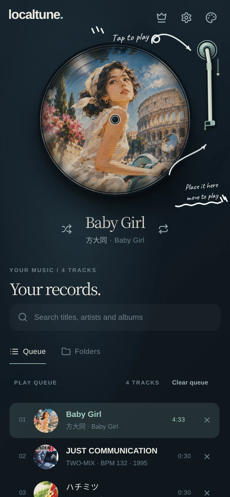
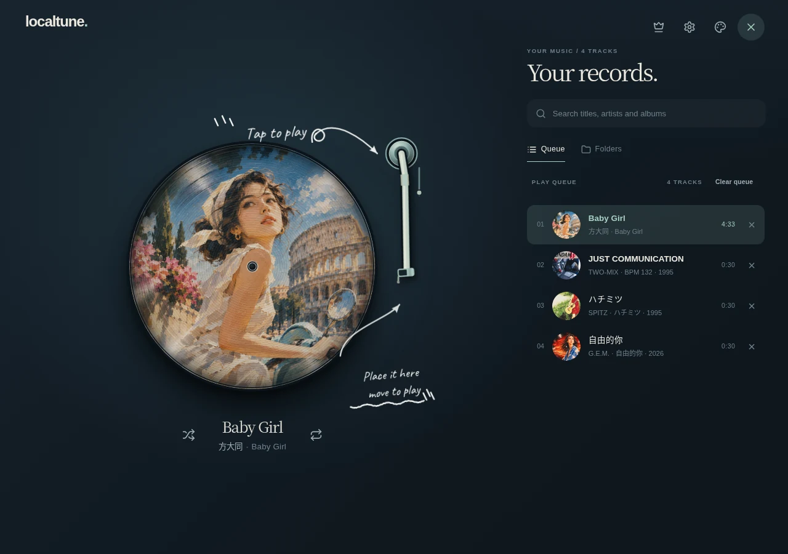

# I Built a Music Player with a $2 Flash Model

*An experiment in what AI agents can build on their own.*

[简体中文](README.zh-CN.md)

---

My $140 Claude Code Max quota ran out, so the project I was working on had to stop. I didn't want to spend another $140 on quota, so I thought: find a cheap model and build something else.

I had wanted to make a local music player for a while, and I couldn't find one online that felt right, so I figured I'd just build one myself.

I already had an Orca agent orchestration system, so I just swapped Conductor, Master, and Worker over to DeepSeek V4.1 Flash to see how far this cheap model could actually go.

## Two days later, it worked

I started on November 4. At 2:11 a.m. on November 6, I sent the live LocalTune to a friend to try.

<http://tune.mainstayx.com>

  
  

LocalTune is a local-first music player that runs entirely in the browser. It reads a local folder, parses music tags and cover art, builds its own library, and supports a play queue, shuffle, and offline use.

Later I added OneDrive, Google Drive, and Dropbox, along with cloud audio caching, 10 languages, PWA auto-updates, and more playback controls.

The app has no backend that handles music. It is a static PWA: the browser manages the music and cloud authorisation directly. I deployed it on my own k3s cluster.

None of these features are a technical breakthrough, of course. What really surprised me was that **it was already a product I could hand to other people, and most of the development was done by Flash.**

From requirements breakdown and technical design to coding, testing, review, merging, building, and deployment, the Orca pipeline drove almost all of it. The project has unit tests, Playwright browser tests, and GitHub Actions, with records for each run.

What's more interesting is that the first delivery on November 6 was not the end.

By November 7 it was still being developed. Google Drive, Dropbox, UI adjustments, playback fixes, and some new interactions all came later, step by step.

By then, the way I took part had changed a little.

I no longer had to keep telling it what to implement next. More often, I just opened it on my phone, used it for a while, and then told it:

> This doesn't feel good to use.
>
> This list shouldn't jump back to the top.
>
> This guide is in the way.
>
> Something seems off when I change tracks.

Some were bugs; some were just UX that wasn't good enough.

The clearest example was the onboarding. It built an overlay-style chalk guide. Functionally there was nothing wrong with it, but when I actually used it on my phone, it felt in the way. So I scrapped it and changed it to hand-drawn annotations in the background.

These are the kinds of problems that are hard to spell out completely in the initial requirements. I only knew what I actually wanted after using it.

## What did I give it?

I didn't give Flash a complete product design document.

At the start, there was one goal and a few important constraints: local-first, purely static, offline-capable, Android and desktop first, and no in-app service for acquiring new music.

For visual design, I did use Claude and ChatGPT to explore different styles, and in the end I picked the one I liked. I also prepared the infrastructure, domain, and OAuth apps.

Implementation was not entirely without manual intervention, either. A few times, I used Cursor to help fix OneDrive playback and caching problems. There were also model-quota and execution-resource limits at the time. The fact that I used Cursor does not simply mean Flash was incapable of doing those tasks.

I did not run a strict model comparison, so I won't use this project to claim that Flash reaches Opus's level on every task.

In practice, Flash was indeed worse than Opus in some places. Especially with design judgement and some details, it doesn't necessarily get them right the first time.

But Orca's orchestration kept pushing the work forward.

The system has roughly three layers:

- **Conductor** takes my requirements, manages tickets, checks progress, and decides what comes next.
- **Master** writes the spec, splits the work, reviews the Worker's output, and integrates the code.
- **Worker** implements and tests a specific slice in an isolated Git worktree.

This time, all three roles used DeepSeek V4.1 Flash.

The rules, acceptance criteria, and handoff mechanism come from the existing [ceo-orchestration](https://github.com/SentimentalK/ceo-orchestration). Tickets, decisions, and execution results are stored in a separate private memory repo, LifeOS.

A ticket isn't done just because the agent replies "Done". You need to check that the code really landed in `main`, that the matching CI passed, that the tests passed, and that the result was written back.

I also set up a daily automatic resume. When the computer wakes up in the morning, Orca starts a new Conductor session, reads the previous day's handoff and to-dos, and continues assigning work.

So for most of those three days, I was not sitting in front of the computer watching it write code.

Usually I opened the live app in the evening, tested it like a normal user, and sent the problems back. Then it continued developing, testing, and delivering.

Of course, passing automated tests doesn't mean there are no problems on a real device. Android background auto-advance still has a platform-related issue, and background playback on iOS still can't be guaranteed to be reliable.

I know all of this, and I didn't hide it to make the experiment look more successful.

## What did two dollars change my mind about?

This was the most surprising part of the experiment.

The Flash model quota used by the whole project worked out to **about two dollars**, converted at the OpenCode Go subscription's quota rate.

That number is not the full development cost, nor an exact bill calculated from API tokens. It doesn't include my time, the earlier design work with Claude and ChatGPT, or the servers and domain I already had.

Even so, the result far exceeded my expectations.

In the past, when I did AI coding, I was used to giving important work to the strongest model. Especially for Master, technical design, and complex tasks — I always felt that a stronger model was safer.

This time, only because the expensive model's quota ran out did I try switching the whole orchestration to Flash.

It not only built the product; it kept taking feedback, fixing problems, and adding features, completing a fairly long development flow.

I certainly don't think Flash can replace Opus yet. Looking at individual tasks, Opus is still stronger, and I'm willing to pay for genuinely complex problems.

But this made me start reconsidering: **do I really need the most expensive model involved in the entire development process?**

Maybe in the future, I only need an expensive model at the start of a project, to discuss requirements, set direction, or handle a few complex architecture problems.

The rest of the technical design, implementation, testing, and integration can first be done by a cheap model under the existing orchestration. When it hits something it really can't solve, then I upgrade the model.

Even technical design itself may not need the most expensive model every time.

I haven't systematically validated this judgment on other projects. LocalTune is just one experiment, in a technical domain I'm familiar with, with existing infrastructure and orchestration.

But it's already enough to change my default choice the next time I start a project.

My old approach was: use the most capable model possible, then think about how to save usage.

Now I'm more willing to try the reverse: start with a model that's cheap enough, organise the work well, and see how far it actually gets.

This time, the answer it gave me was a live music player that I'm happy to open every day.

> **Two dollars. What more do you want — a bicycle?**

---

## Project and links

- [Try LocalTune](https://tune.mainstayx.com)
- [Orca / CEO Orchestration](https://github.com/SentimentalK/ceo-orchestration)
- [LocalTune on GitHub](https://github.com/SentimentalK/LocalTune)

The app is still being improved. If you try it, I'd love to hear where it feels uncomfortable. That feedback is now the main input for the next round.
