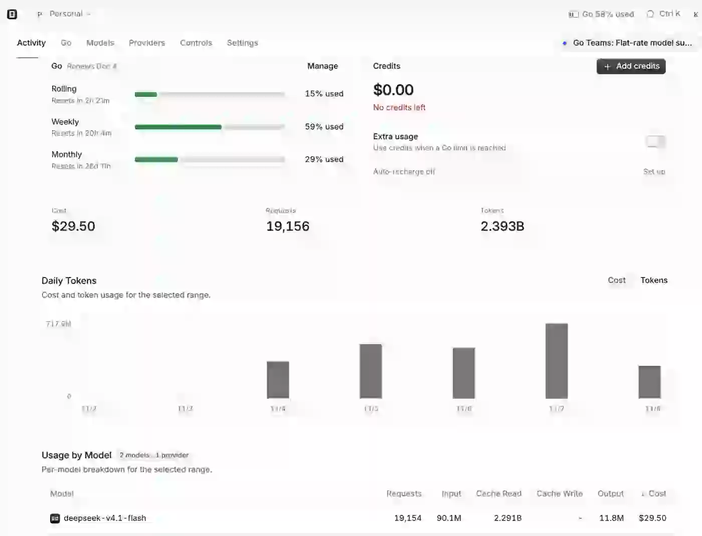

# I Built a Music Player with DeepSeek V4.1 Flash for $3

*An experiment in how far a cheap AI model can go.* · [简体中文](README.zh-CN.md)

---

I ran out of usage on my $140/month Claude Code Max plan, so I put my current project on hold. I wasn't about to spend another $140, so I figured I'd try a cheaper model and build something else.

I'd wanted to make a local music player for a while, but couldn't find one I really liked. So why not just build my own?

I already had an Orca agent orchestration system, so I swapped Conductor, Master, and Worker over to DeepSeek V4.1 Flash to see how far this cheap model could actually go.

## Two days later, it worked

I started on November 4. By 2:11 a.m. on November 6, I'd already shared LocalTune with a few friends to try. <https://tune.mainstayx.com>

  

By then, it could manage a local music library, connect to OneDrive, read music tags and cover art, play offline, and it already had the vinyl turntable interface. The whole thing is a static PWA. Music is handled directly in the browser, and the app runs on my own k3s cluster.

From breaking down requirements and technical design to coding, testing, and deployment, Flash did most of the work through Orca. And it didn't stop after launch. It went on to add Google Drive and Dropbox, fix bugs, tweak the UI, and add more features.

At this point, I mostly just use it on my phone, complain when something doesn't feel right, and let the agent fix it.

For example, the library would sometimes jump back to the top after syncing, or certain interactions just felt awkward. At one point, it built an onboarding guide that covered the interface. I found it annoying, so I had it replaced with chalk annotations in the background.

None of these details were in my original requirements, because I hadn't thought that far ahead myself. Now I basically use the app, find things I don't like, and give feedback. The agent keeps working on them. By November 7, development was complete.

## What did I actually give it?

I didn't start with a complete design document. Just a goal and a few constraints: local-first, static, offline-capable, with Android and desktop browsers as the priorities.

I explored a few UI directions with Claude and ChatGPT, then picked the one I liked. I also handled the infrastructure: k3s, the domain, and OAuth setup. I used Cursor for a few OneDrive playback and caching fixes, partly because I was running into usage limits at the time.

What kept the whole thing moving was the [CEO Orchestration](https://github.com/SentimentalK/ceo-orchestration) system I'd already built. Conductor manages tasks, Master handles design and code review, and Workers write code and run tests in isolated Git worktrees. This time, all three roles ran on Flash.

Tasks and execution records live in a separate Markdown-based memory repository. Before closing a ticket, the system checks that the code is merged, CI passes, tests pass, and the results are recorded. It doesn't just take the agent's word for it.

I also set up automatic daily resumption. Every morning, after my computer wakes up, Orca starts a fresh Conductor session, reads the previous day's handoff, and picks up where it left off.

So I wasn't sitting at my computer for most of those three days. I'd check the results in the evening, give some feedback, and let it continue the next day.
## What $3 Made Me Rethink

The biggest surprise was the cost.

Over those few days, Flash used 29% of my monthly OpenCode Go quota, which works out to about **$3**.

  

That obviously doesn't include my time, the earlier design work, or the servers I already had. But the model usage really was that cheap.

I'd always assumed that for more complex agent workflows, especially the Master role and technical design, I should use a strong model like Opus. Workers could use something cheaper, sure, but the model doing the planning and reviewing needed to be powerful, right?

This time, I switched all three roles to Flash simply because I'd run out of quota on the expensive model. And it built the product, kept iterating on its own, and handled pretty much the entire development loop: technical design, implementation, testing, integration, and deployment.

I don't think Flash is better than Opus. Opus is clearly stronger at certain design decisions and details. But **is that difference really worth paying for an expensive model throughout the entire development process?**

I'm starting to rethink how I use these models.

Maybe I'll use expensive models mainly at the beginning of a project to figure out requirements and direction, or when I run into something genuinely difficult. For implementation, and even most of the technical design, I'd rather start with Flash and move up only when needed.

I used to think that when a model wasn't good enough, the answer was to use a stronger one. This experiment made me realize that sometimes you don't need a stronger model at all. Break the work down properly, give it a decent orchestration system and clear acceptance checks, and a cheap model can get surprisingly far.

It's only one project, and I still want to try this on other projects before drawing bigger conclusions. But it's already changed how I think about small models.

**Three bucks. What more could I ask for?**

---

## Links

- **Try LocalTune:** https://tune.mainstayx.com
- **LocalTune on GitHub:** https://github.com/SentimentalK/LocalTune
- **CEO Orchestration:** https://github.com/SentimentalK/ceo-orchestration