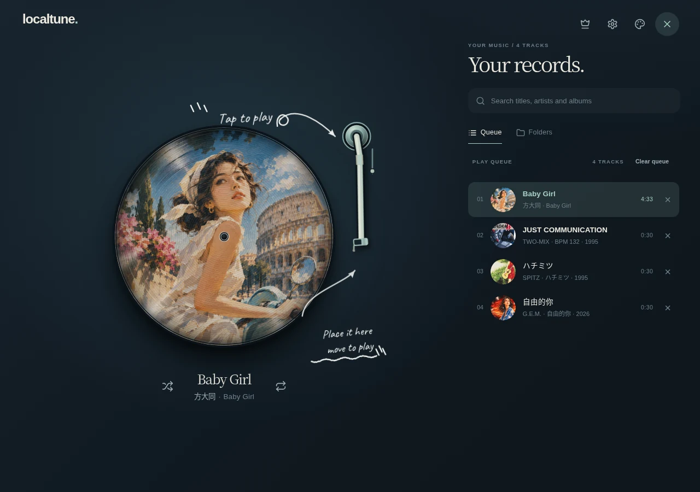
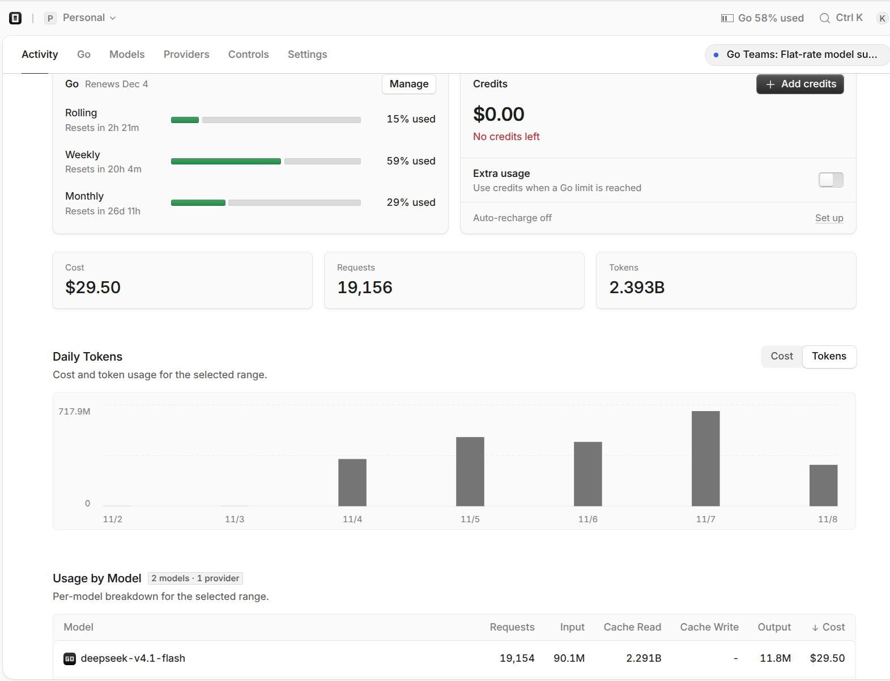

# 我用 DeepSeek V4.1 Flash **花了 3 美元**做了一个音乐播放器

*一次关于 AI Agent 自主开发能力的实验。*[English](README.md)

---

我的 $140 Claude Code Max 额度用光了，之前的项目只能先停下来。我又不想再花 $140 买额度，就想着找个便宜模型做点别的。

正好一直想做个本地音乐播放器，网上也没找到特别顺手的，那就自己搓一个呗。

手里已经有一套 Orca Agent 编排系统，干脆把 Conductor、Master、Worker 全部换成 DeepSeek V4.1 Flash，看看这个便宜模型到底能走多远。

## 两天后，它已经能用了

11 月 4 日开始，11 月 6 日凌晨 2:11，我已经把上线的 LocalTune 发给朋友们试用了。<https://tune.mainstayx.com>

  

那时候它已经能管理本地曲库、连接 OneDrive、读取音乐标签和封面、离线播放，也有了黑胶唱机的界面。整个应用是纯静态 PWA，音乐直接在浏览器里处理，部署在我自己的 k3s 集群上。

从需求拆分、技术设计、编码、测试到部署，主要都是 Flash 通过 Orca 完成的。而且上线后它也没停，后面又接入了 Google Drive 和 Dropbox，继续修 Bug、调整界面、加功能。

我现在更多是在手机上实际使用，发现哪里不好用就提反馈。比如曲库同步后列表会突然跳回顶部，或者某些操作不太顺手。还有一次，它做了一套覆盖在界面上的新手引导，我用着觉得太碍事，就让它改成背景里的粉笔标注。

这些细节我一开始根本没写进需求，因为我自己也没想那么细。现在基本就是我负责用、负责挑毛病，Agent 负责继续改。到 11 月 7 日，开发已经全部完成。

## 我给了它什么？

其实一开始我并没有给它一份完整的设计文档，就是一个目标，加上几个约束：本地优先、纯静态、离线可用，优先支持 Android 和桌面浏览器。

UI 设计我用 Claude 和 ChatGPT 探索过几版，最后选了自己喜欢的风格。k3s、域名、OAuth 这些基础设施也是我准备的。中间有几次 OneDrive 播放和缓存问题，我用 Cursor 帮忙修过，当时也有额度方面的原因，并不代表 Flash 做不了。

真正让它能持续干活的，还是我之前搭好的 [CEO Orchestration](https://github.com/SentimentalK/ceo-orchestration)。Conductor 负责管任务，Master 负责设计和 Review，Worker 在独立的 worktree 里写代码、跑测试。这次三个角色全部换成了 Flash。

任务和执行记录放在 MD记忆仓库里，完成一张票要检查代码、CI、测试结果和记录写回，不能光听 Agent 说完成了。我还设置了自动续跑，每天早上电脑唤醒后，Orca 会开一个新 session，读昨天的交接继续做。

所以这几天我大部分时间都没在电脑前。晚上看看成果，提点意见，第二天它接着干。

## 3 美元改变了我什么看法？

最让我意外的是成本。

这几天 Flash 用掉了 OpenCode Go 月度额度的 29%，折算下来大概 **3 美元**。当然，这不算我自己的时间、前期的设计投入和已有的服务器成本，但模型用量确实就这么多。

  

我之前一直觉得，复杂一点的 Agent 工作流，尤其是 Master 和技术设计，最好还是用 Opus 这种强模型。Worker 可以便宜一点，但负责思考和 Review 的模型总得足够强吧？

这次纯粹是因为贵模型额度用完了，才把三个角色全换成 Flash。结果它不光把产品做出来了，还能自己持续迭代，从技术设计到实现、测试、集成、部署，基本都跑通了。

我不觉得 Flash 比 Opus 强。有些设计和细节处理，Opus 确实做得更好。但问题是，**这些差距真的值得我在整个开发过程中一直付那么贵的模型费用吗？**

现在我有点想改变自己的用法了。以后可能只在项目刚开始的时候，用贵模型讨论需求、确定方向，或者遇到复杂问题再找它。至于具体实现，甚至大部分技术设计，完全可以先让 Flash 去做。

以前总觉得模型能力不够，就应该换更强的模型。这次发现，可能很多时候不需要换模型，先把任务拆好，把编排和验收做好，便宜模型也能完成相当多的工作。

当然，这只是 LocalTune 这一个项目，我还得在其他项目上继续验证。但至少它已经改变了我对小模型的看法。

**3 美元，还要啥自行车？**

---

## 项目与相关链接

  - [LocalTune 在线试用](https://tune.mainstayx.com)
  - [Orca / CEO Orchestration](https://github.com/SentimentalK/ceo-orchestration)
  - [LocalTune GitHub 仓库](https://github.com/SentimentalK/LocalTune)